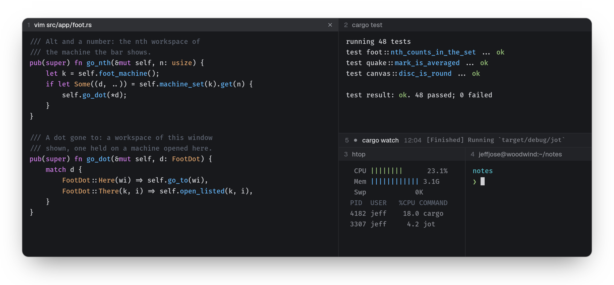
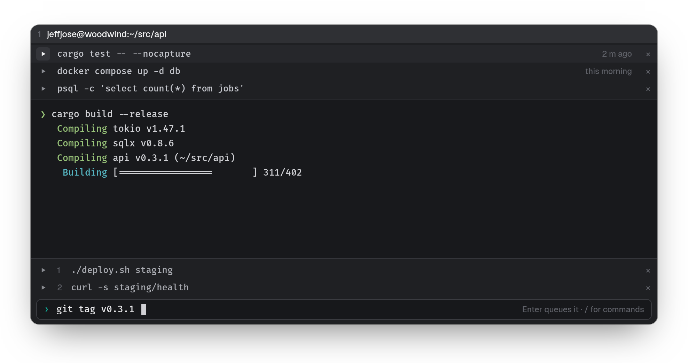
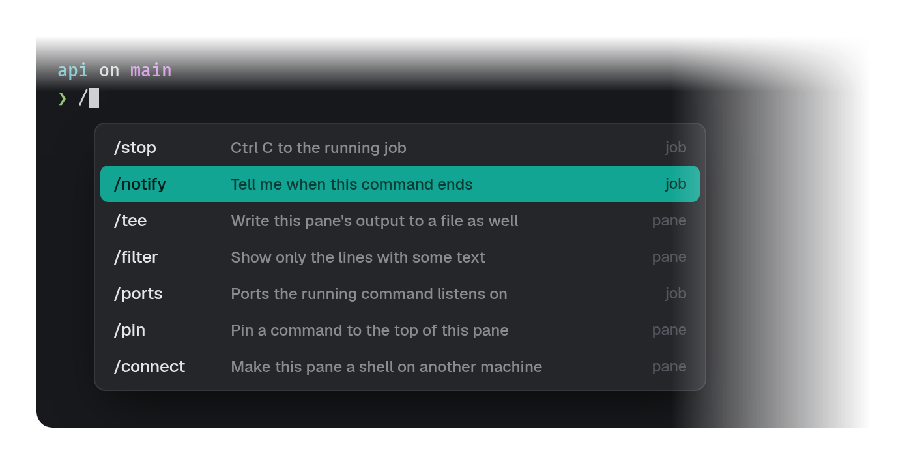
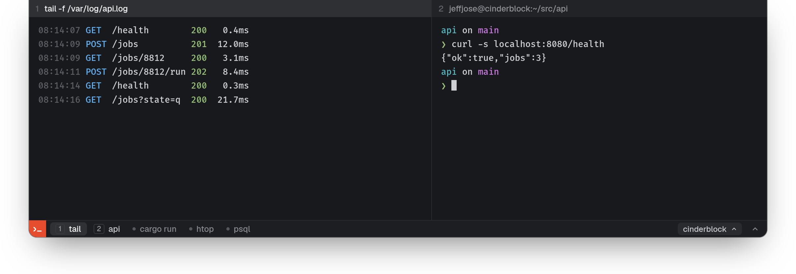

#  jot

A terminal emulator with built-in splits and workspaces, for Linux (X11
and Wayland). Built on [libghostty-vt](https://mitchellh.com/writing/libghostty-1-0).

<p align="center"></p>

```sh
git clone --recurse-submodules git@github.com:jeffjose/jot.git
cd jot && cargo build --release   # needs Zig 0.17
target/release/jot setup          # add it, with its icon, to your programs
```

### Split it up

Start with one terminal. `Alt V` splits it to the right, `Alt S` down; drag
a pane by its caption to put it somewhere else, or drag the lines between
them. A pane you need not watch shrinks to a single row that keeps
running and shows its last line; a click brings it back.

A set of panes is a workspace, each with a color of its own: `Ctrl N`
makes another, `Alt 1`…`9` goes there.

<p align="center"></p>

### Commands, close at hand

Pin the commands you keep running to the top of a pane and run one with a
click. `Alt ;` opens the pane's own command line: type while something is
still running and it waits its turn, each in the queue there to run now or
take out.

<p align="center"></p>

Type `/` at a prompt for jot's own commands: stop or kill what is running,
be told when it ends, write its output to a file, show only the lines that
matter, see the ports it listens on.

<p align="center"></p>

### Close it, keep it

Every terminal runs in a session that outlives the window. Close the window
and the shells, builds and logs carry on; run `jot` and they are back where
you left them. After a reboot, jot offers your layout and scrollback again.

<p align="center"></p>

### Other machines

Add a machine and its terminals sit in the sidebar beside this one's, as
close as local ones; `/connect host` turns any pane into a shell over
there. The bar shows one machine's workspaces at a time; its machine button
switches to another's.

<p align="center"></p>

### Quake

Bind a key to `jot --quake` and a terminal drops from the top of the
screen, split as you like and laid out once for this desk. Its bar lists
every terminal of a machine: pick one and the pane you are in shows it.

<p align="center"></p>

### And the small things

- `Ctrl F` finds in a pane; `Alt P` walks its scrollback from the keyboard.
- `Ctrl` click a link to open it, or a path (`src/app.rs:42`) to open it in your editor.
- `Ctrl Shift ↑` `↓` jumps from prompt to prompt; a long command that ends out of sight says so.
- Long commands open in an editor of their own (`/edit`), to break over lines.
- `Alt Shift M` types into every pane at once; `Alt Shift O` moves a pane to a window of its own.
- `` Alt ` `` brings a roaming terminal over whatever workspace you are in.

Keys are listed in Settings (`Ctrl ,`); `jot --help` lists the rest.
