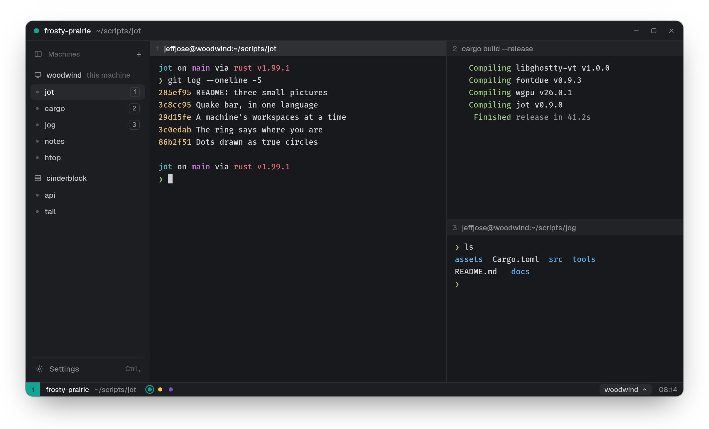
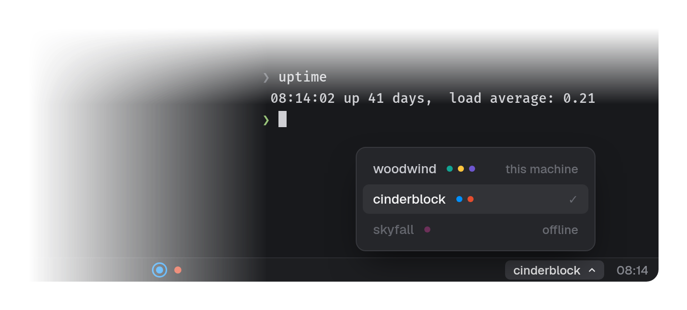
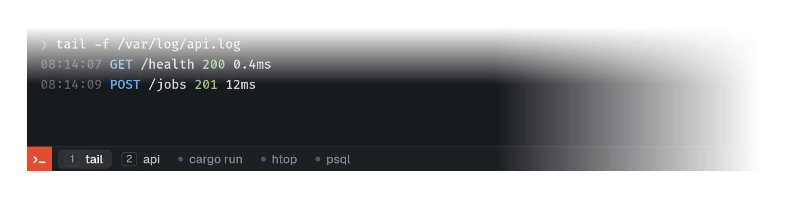

#  jot

A terminal emulator with built-in splits and workspaces, for Linux (X11
and Wayland). Built on [libghostty-vt](https://mitchellh.com/writing/libghostty-1-0).

<p align="center"></p>

```sh
git clone --recurse-submodules git@github.com:jeffjose/jot.git
cd jot && cargo build --release   # needs Zig 0.17
target/release/jot setup          # add it, with its icon, to your programs
```

### Terminals that stay

Every terminal lives in a session on its machine, so closing a pane or the
window only stops looking at it. Add a machine and its terminals and
workspaces sit beside this one's; the bar shows one machine's workspaces at
a time.

<p align="center"></p>

### Quake

`jot --quake` drops a terminal from the top of the screen, laid out once for
this desk. Its bar lists every terminal of a machine; pick one and the pane
shows it.

<p align="center"></p>

Keys are listed in Settings (`Ctrl ,`); `jot --help` lists the rest.
