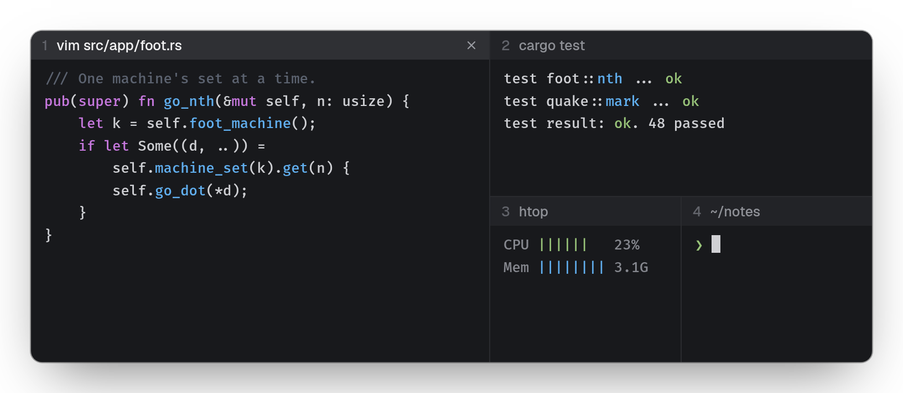
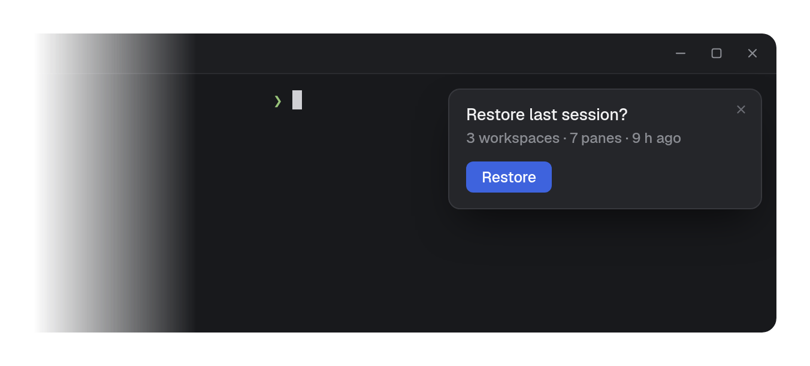
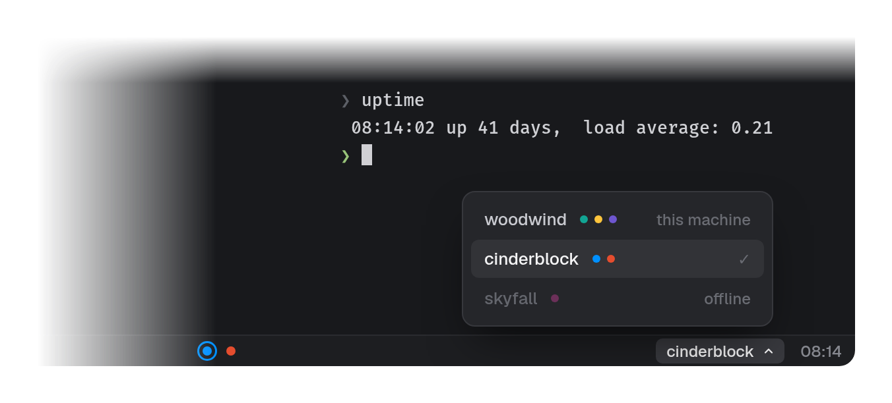
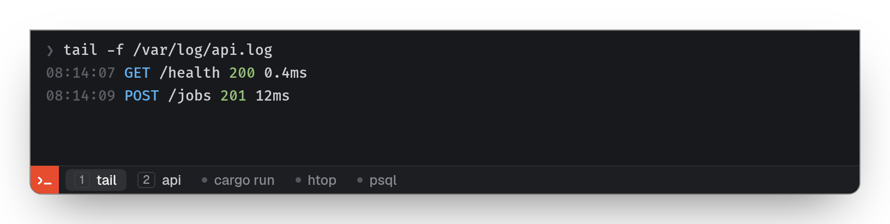

#  jot

A terminal emulator with built-in splits and workspaces, for Linux (X11
and Wayland). Built on [libghostty-vt](https://mitchellh.com/writing/libghostty-1-0).

<p align="center"></p>

```sh
git clone --recurse-submodules git@github.com:jeffjose/jot.git
cd jot && cargo build --release   # needs Zig 0.17
target/release/jot setup          # add it, with its icon, to your programs
```

### Split it up

Start with one terminal. `Alt V` splits it to the right, `Alt S` down; drag
a pane by its caption to put it somewhere else. A set of panes is a
workspace, each with a color of its own: `Ctrl N` makes another, `Alt 1`…`9`
goes there.

<p align="center"></p>

### Close it, keep it

Every terminal runs in a session that outlives the window. Close the window
and the shells, builds and logs carry on; run `jot` and they are back where
you left them. After a reboot, jot offers your layout and scrollback again.

<p align="center"></p>

### Other machines

Add a machine and its terminals sit in the sidebar beside this one's, as
close as local ones. The bar shows one machine's workspaces at a time; its
machine button switches to another's.

<p align="center"></p>

### Quake

Bind a key to `jot --quake` and a terminal drops from the top of the screen,
laid out once for this desk. Its bar lists every terminal of a machine: pick
one and the pane shows it.

<p align="center"></p>

Keys are listed in Settings (`Ctrl ,`); `jot --help` lists the rest.
